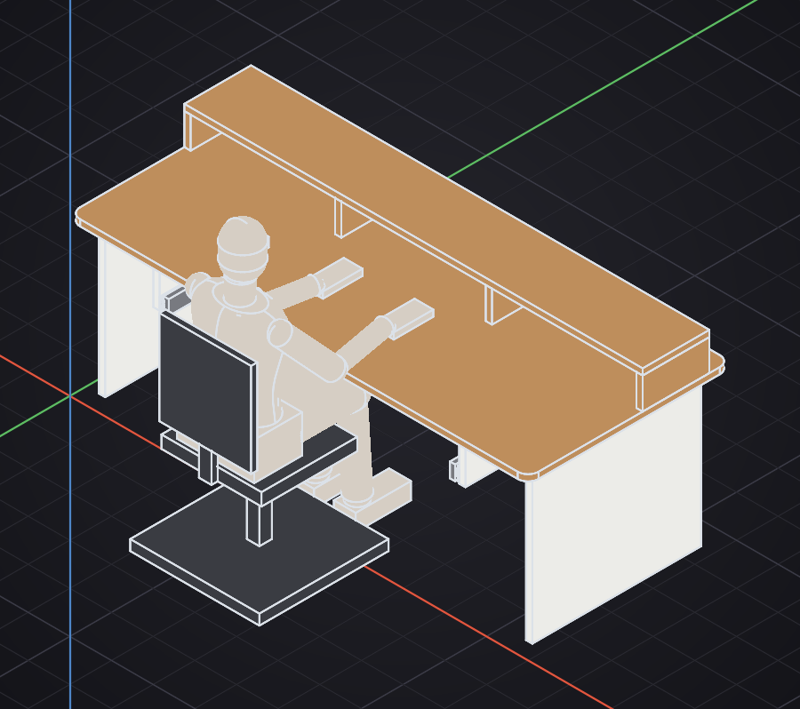
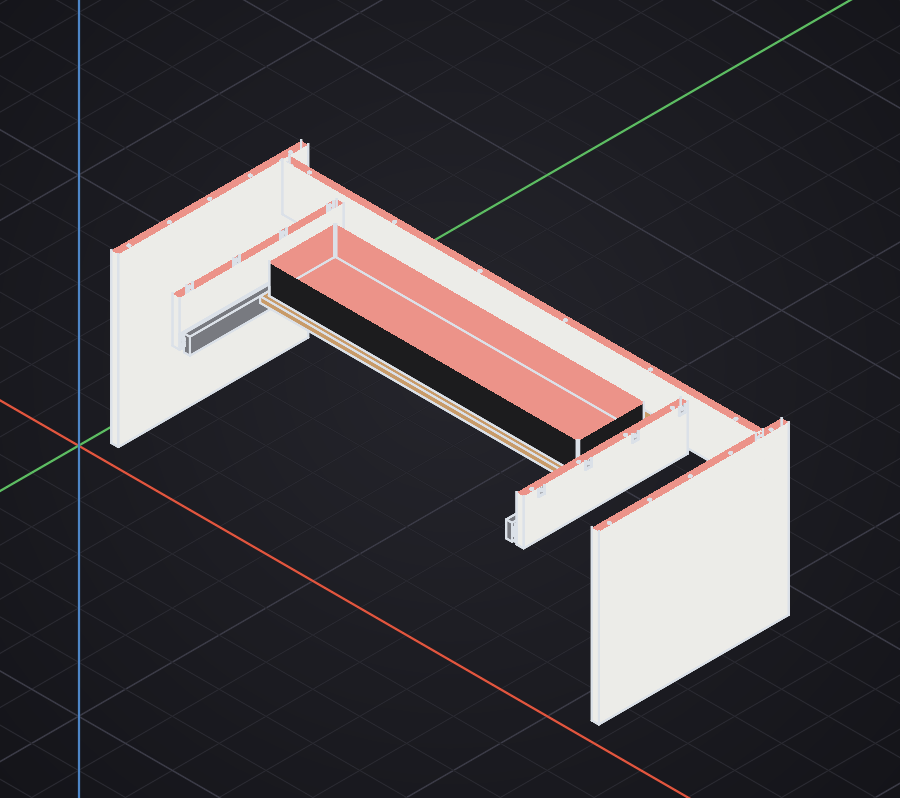
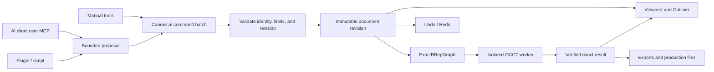

# Ketchup

> [!WARNING]
> ## Work in progress — not a finished product
>
> **Ketchup is under active development and is still far from a finished, stable release.**
>
> You are welcome to download it, build it, and look around — but expect missing features, rough edges, breaking changes, and bugs. Please do not rely on it for real work or keep important models only in Ketchup yet.

<p align="center">
  
</p>

<p align="center">
  <strong>Open-source 2D/3D parametric modeling with exact geometry and safe, undoable AI.</strong>
</p>

<p align="center">
  Windows x86-64 · Rust · Open CASCADE Technology · wgpu · Apache-2.0
</p>

Ketchup is an AI-native desktop modeler for creating, editing, assembling, validating, and exporting real geometry. Manual tools and AI clients connected over MCP share the same canonical command path: every accepted model change is validated, revision-bound, atomic, and undoable. A model can also be a short rule program (Starlark) that you or an AI writes; edits in the window are written back into that program.

<p align="center">
  
  
</p>

<p align="center">
  <em>A 2.2 m studio desk designed in Ketchup with an AI agent over MCP. Left: the desk with a 180 cm reference figure and chair. Right: a section plane under the top shows the keyboard tray for a stage piano. It runs on Hettich KA 4620 full-extension slides, imported as exact STEP, and its hangers are held by stainless angle brackets.</em>
</p>

## Download and try it

1. Download **`Ketchup-0.2.0-Setup.exe`** from the [latest release](https://github.com/pietrobb/Ketchup/releases/latest) and run it. It installs for the current user only, without administrator rights, into `%LOCALAPPDATA%\Programs\Ketchup` and adds **Ketchup** and **Ketchup Viewer** to the Start menu. If you prefer not to install anything, use `Ketchup-0.2.0-Portable.zip` from the same release.
2. Download **`Ketchup-0.2.0-Examples.zip`** from the release, unpack it, and double-click any `.ketchup` file to open it in Ketchup. Double-click `kitchen.ketchup-view` to open it in Ketchup Viewer. The examples are described [below](#examples-you-can-open-right-away).
3. Optional: connect the AI harness you already use, such as Claude Code, Codex, Claude Desktop, or Cursor. It can then model in the open Ketchup window. See [Connect your AI harness](#connect-your-ai-harness-mcp).

Requires Windows 10 or 11 x64. The installer and the programs are signed by AEON GROUP spol. s r.o. No account, API key, or Python is needed.

## What you can do today

| Model | Organize and edit | Deliver |
|---|---|---|
| Draw lines, arcs, circles, rectangles, polygons, ellipses, and splines with snapping and typed lengths | Reuse definitions through occurrences and components; group, Make Unique, Replace Component | Save checksummed `.ketchup` documents; a crash leaves a work-recovery copy |
| Push/Pull, pocket, holes with ISO metric threads, revolve, sweep, loft, helix, shell, fillet, chamfer, draft, and planar offset | Move, copy, rotate, mirror, align, distribute, and build linear, rectangular, and circular patterns | Import STEP and IGES (exact), STL, Blender GLB, DXF and DWG, and the `.kscene` SketchUp bridge |
| Exact cut, union, intersect, and split | Edit ordered feature history, sketch constraints, dimensions, layers (tags), and saved views | Export STEP, IGES, STL, 3MF, Blender GLB, COLLADA for SketchUp, and a Ketchup Viewer package |
| Write the model as a parametric rule program with parameters and saved variants | Assemble with mates, joints, travel limits, gear/belt/chain/rack/screw couplings, and motion studies | Drawing sheets with front, top, right, isometric, auxiliary, section, and detail views; project drawings to PDF, DXF, and DWG |
| Keep a DXF or DWG drawing under the model as an underlay, snap to it, and fit it by two points | Measure distances, volume, mass, centre of mass, and moments of inertia | Cut lists, hardware lists, bar schedules, and material takeoff as CSV/XLSX; Hundegger BTLx, HOMAG woodWOP, a reviewed CAM program, sheet-metal flat patterns, and weldment cut lists |

Ketchup also checks what it builds: collisions and clearances, parts that rest on nothing, load paths with self-weight, imposed and snow loads, and timber members after EN 1995-1-1 (EC5). Checks report issues instead of blocking your edits.

Advanced operations are intentionally bounded and fail closed when geometry, identity, resource, or worker guarantees cannot be met. This table describes tested product paths, not unrestricted support for every shape or imported model. Underlays, COLLADA export, writing window edits back into a program, and the in-memory Undo described under [Build and run](#build-and-run) are on `main` and newer than the 0.2.0 release.

## Examples you can open right away

The examples below are in `Ketchup-0.2.0-Examples.zip` on the [release page](https://github.com/pietrobb/Ketchup/releases/latest) and in the [`examples`](examples) folder of this repository. `tiny-house.ketchup` is too large for the repository; download it from the link in the table. Double-click a file or use **File → Open**.

The [`hettich-quadro-v6-drawer.ketchup`](examples/hettich-quadro-v6-drawer.ketchup) example is an articulated drawer assembly. It combines an editable assembly with embedded exact STEP components, reusable occurrences, stable mechanical references, joints, travel limits, a coordinated motion study, and a persisted mounting contract. Its geometry and engineering intent stay connected, which is what Ketchup is built for.

| Example | Try it for |
|---|---|
| [`hettich-quadro-v6-drawer.ketchup`](examples/hettich-quadro-v6-drawer.ketchup) | The drawer assembly described above, with joints, travel limits, and a motion study. |
| [`table.ketchup`](examples/programs/table.ketchup) | A small table driven by a rule program ([`table.star`](examples/programs/table.star)). It is a good first model to edit by hand or with AI: moving, turning, mirroring, deleting, renaming or recolouring a part, or changing a value in the parameter panel, is written into the program, so the table stays parametric. |
| [`wardrobe-chair-table.ketchup`](examples/wardrobe-chair-table.ketchup) | Furniture with 82 bodies and hundreds of drilled holes. |
| [`tiny-house.ketchup`](https://github.com/pietrobb/Ketchup/releases/download/sample-files/tiny-house.ketchup) | A timber-frame house of about 750 parts, with studs, noggins, and insulation, generated from [`tiny-house.star`](examples/programs/tiny-house.star). You can try layers, material takeoff (**Tools**), and project drawings. A 25 MB download from the [sample files](https://github.com/pietrobb/Ketchup/releases/tag/sample-files) release. |
| [`house-project.ketchup`](examples/house-project.ketchup) | A larger house generated from [`house-project.star`](examples/programs/house-project.star). |
| [`garden-studio-colored.ketchup`](examples/garden-studio-colored.ketchup) | A colored garden studio built from exact solids. |
| [`grooved-beam-array.ketchup`](examples/grooved-beam-array.ketchup) | A 480-occurrence timber stress scene with 24 shared definitions. Use it to test the viewport, selection, the Outliner, and instancing. |
| [`kitchen.ketchup-view`](viewer/samples/kitchen.ketchup-view) | A read-only package for **Ketchup Viewer**, where you can review a model and save comments. |

The rule programs behind several of these models are in [`examples/programs`](examples/programs), together with programs you can apply to an empty model: a cabinet, a modular doweled cabinet, shelves on a shared partition, a round stool, and an anchored beam. An AI harness can read them and use them as templates.

## One path from intent to geometry



AI proposals cannot write around validation, persistence, or Undo/Redo. Stale, invalid, oversized, timed-out, or disconnected proposals are rejected without replacing the last valid model.

## Modeling capabilities

### Rule programs

A model can be a [Starlark](https://github.com/bazelbuild/starlark) rule program instead of a list of absolute pieces. Parts are placed by relation (`on`, `flush`, `between`, `distribute`), machined with holes, pockets, grooves, rebates and booleans, and joined with dowels, hardware, and standard fasteners (ISO and DIN nuts, bolts, washers, threaded rods, reinforcing bars). `param()` values appear in the parameter panel and can be saved as variants; **Export all variants** writes the cut list and material takeoff of every variant at once.

Moving, turning, mirroring, deleting, renaming, or recolouring a program part in the window, or typing a new value for it, is written into the program, so the model stays parametric. An edit the program cannot express, such as scaling or adding new geometry, detaches the program, and the notice names the part and the reason.

The language and its library are described in [docs/program-language.md](docs/program-language.md). Example programs are in [`examples/programs`](examples/programs).

### Sketching and parametric history

- Principal, offset, and planar-face workplanes.
- Line, arc, circle, polygon, ellipse, and spline entities with deterministic region extraction and holes.
- Bounded geometric solving for horizontal, vertical, coincident, distance, radius, fixed-point, parallel, perpendicular, tangent, angle, equal, symmetric, concentric, collinear, midpoint, and point-on-curve constraints.
- Ordered body/feature history, dimensional edits, hole/slot repositioning, feature suppression/resume, and multi-body activation.

### Exact geometry

Exact bodies are evaluated through a supervised, versioned worker backed by Open CASCADE Technology. Current bounded operation families include extrusion, pocket, Boolean cut/union/intersect/split, revolve, sweep, loft, shell, fillet, chamfer, and signed planar offset. Accepted results carry freshness and topology evidence before they can drive rendering, picking, or export.

### Assemblies and drawings

- **Assemblies:** reusable occurrences, grounding, coincident, concentric, distance, and angle mates with rigid-solve diagnostics; fixed, revolute, prismatic, and helical joints with travel limits; gear, belt, chain, rack-and-pinion, and lead-screw couplings; mechanism drag with swept collision checks; motion studies.
- **Drawings:** persisted drawing sheets with front, top, right, isometric, auxiliary, section, and detail views, associative dimensions, and notes, exported as DXF or DWG. Project drawings (floor plan, sections, elevations) go to PDF, DXF, or DWG.

This is an evolving assembly and drafting path, not yet a complete mechanical simulation or drafting suite.

### Underlays

**File → Import DXF/DWG as underlay…** keeps a drawing under the model, for example a site plan or a floor plan, without turning it into parts. It never reaches the cut list, collision checks, or production exports. Each drawing layer becomes a layer you can hide, lines keep their color, linetype, and lineweight, and texts are shown on their own layers. The drawing tools snap to its endpoints, midpoints, and crossings, and **Tools → Fit underlay to model** places it by two points on its lines and two points in the model. A selected underlay moves and turns with the Move and Rotate tools. National grid coordinates (such as S-JTSK, hundreds of kilometres from the origin) keep their precision, and what cannot be drawn exactly, such as an xref, is named in the import report.

### Imports and exports

- **STEP and IGES:** exact B-Rep import with preserved source bytes. STEP keeps assembly hierarchy, repeated instances, names, and colors; IGES has no hierarchy, so its parts become independent roots.
- **STL:** binary/ASCII import with declared units and strict closed-manifold validation; no silent repair.
- **DXF and DWG:** a bounded 2D geometry subset with a loss report, or a whole drawing as an underlay; a DWG is read as the DXF it converts to.
- **Blender GLB:** mesh import preserving names, hierarchy, transforms, opaque colors, and shared instances. Imported geometry stays a mesh; boxes, cylinders, and linear extrusions can be converted to exact features after verification.
- **SketchUp bridge:** open `.kscene` interchange subset rather than native `.skp` parsing.
- **Export:** the visible exact model to STEP and IGES; tessellation to STL, 3MF, and Blender GLB; COLLADA for SketchUp, where equal parts become one component; and a `.ketchup-view` package for Ketchup Viewer. All exports check freshness and write a loss report where something is left out.
- **Production:** cut lists, hardware lists, bar schedules, and material takeoff as CSV or XLSX; a general BOM with drawings; Hundegger BTLx 2.3.1 for timber members; HOMAG woodWOP drilling programs; a reviewed ISO metric CAM program; sheet-metal flat patterns with bend tables; and weldment cut lists.

### Ketchup Viewer

Ketchup Viewer opens a read-only `.ketchup-view` package exported from Ketchup. A customer can orbit the model, pick a part to see its name, material, size, and notes, switch the saved scenes, and send back comments with arrows and the camera position, without being able to change the geometry. The Windows Viewer is installed with Ketchup; Android, macOS, and a static web version that runs entirely in the browser ([hosting guide](viewer/web/HOSTING.md)) share its code in `viewer/`.

## Connect your AI harness (MCP)

Ketchup has no built-in chat. Instead, you connect the AI harness you already use, such as Claude Code, Codex, Claude Desktop, or Cursor. Your harness keeps its own model, account, and subscription. Ketchup doesn't need an API key.

`Ketchup.exe --mcp` runs a [Model Context Protocol](https://modelcontextprotocol.io) server on stdio. A connected harness works in the Ketchup window you have open. It can read, patch, and apply the model's program, set its parameters and variants, inspect and measure parts, make verified edits, undo, save, and render images of the viewport, including saved views and section cuts. It can also import STEP, IGES, STL, DXF, DWG, GLB, and SketchUp scene files, bring in and fit underlays, and export STEP, IGES, STL, 3MF, GLB, COLLADA, DXF, BTLx, woodWOP, cut-list CSV, Viewer packages, project drawings as PDF, and drawing sheets as DXF or DWG. Every AI edit goes through the same validation and Undo as a manual edit.

The **Connect AI** section of the window's side panel shows whether a harness is connected. It also has the set-up command with the correct path, ready to copy. With the default installation, the commands are:

Claude Code (PowerShell):

```powershell
claude mcp add ketchup -- "$env:LOCALAPPDATA\Programs\Ketchup\Ketchup.exe" --mcp
```

Codex (PowerShell):

```powershell
codex mcp add ketchup -- "$env:LOCALAPPDATA\Programs\Ketchup\Ketchup.exe" --mcp
```

Other harnesses take the same command in their MCP configuration. Replace `<you>` with your Windows user name:

```json
{ "mcpServers": { "ketchup": { "command": "C:\\Users\\<you>\\AppData\\Local\\Programs\\Ketchup\\Ketchup.exe", "args": ["--mcp"] } } }
```

Then ask the agent, for example, to *"open tiny-house.ketchup in Ketchup and make the house 1 m longer"* or *"model a 120 × 60 cm desk with two drawers"*.

The tools connect to the open window by themselves (with several windows open the agent picks one); if none is open, the agent can start one. A newly connected client replaces the previous one, and the window shows a Disconnect button while a client is connected.

When an agent also develops Ketchup in this checkout, use `scripts\ketchup-mcp-server.cmd` as the command instead. It runs the server from `target\mcp-server` and the windows it opens from copies of the newest build under `target\mcp-windows`, so `cargo build --release` can replace `target\release` while those windows stay open.

## Build and run

The supported development platform is **Windows x86-64** with Rust 1.97.0 and OCCT 8.0.1. See the [Windows toolchain guide](docs/toolchain/WINDOWS.md) for the pinned native environment.

```powershell
cargo build --locked --release
target\release\ketchup-app.exe
```

The release build includes the exact and program workers the window starts beside itself.

Validate the workspace with the commands of [AGENTS.md](AGENTS.md) §6 and §8:

```powershell
cargo test --locked --workspace --all-targets
cargo test --locked --workspace --all-targets -- --ignored large_house
cargo clippy --locked --workspace --all-targets -- -D warnings
cargo fmt --all -- --check
Get-ChildItem scripts\check_*.py | ForEach-Object { python $_.FullName }
python scripts\run_production_tests.py
```

Filter a run after `--` (for example `-- member_design::`). The last command runs the Python tests that drive the built headless CLI and fails on any skip. Install the pre-push hook, which runs fmt, the checks and Clippy, once per clone with `git config core.hooksPath scripts/hooks`.

The Rust workspace also builds on Linux against an OCCT 8.0.1 install in the Unix layout (`include/opencascade`, `lib`). Point `KETCHUP_OCCT_ROOT` at it and make the libraries loadable, for example with `RUSTFLAGS="-C link-arg=-Wl,-rpath,$KETCHUP_OCCT_ROOT/lib"`.

No stable public API or long-term native file-format compatibility is promised yet. Undo/Redo lives in memory for the session and reaches back 30 edits: Save writes only the current revision, and reopening a file starts a new Undo history. A named checkpoint in the revision catalog is saved with the file only when it names the revision you save, so save right after naming it; a checkpoint on an earlier edit lasts only for the session, and 30 newer edits drop it. While you work, a work-recovery copy beside the file keeps your edits and their Undo steps, so a crash loses neither.

A newer Kečup opens the files of an older one, but not the other way round. Kečup 0.2.0 and later refuse a file a newer version saved and change nothing. **Do not go back to 0.1.0 with files a later version has saved:** 0.1.0 takes such a file for a damaged one and opens, without saying so, the `.recovery` copy beside it, which holds the content before that save, and saving there can overwrite the newer file.

## Architecture

Ketchup has one canonical, revisioned document and one validated mutation gateway. Geometry workers, rendering, picking, drawings, validation, imports, exports, UI, plugins, and AI are projections or clients of that authority rather than parallel model stores.

Read project authority in this order:

1. [`AGENTS.md`](AGENTS.md): the working rules for every contributor and coding agent. Generic geometry only in the core; validators report instead of blocking; only data-protecting checks.
2. [Accepted ADRs](docs/adr) for the decisions they own. [ADR 0008](docs/adr/0008-retire-gate-governance.md) retired the gate and preregistration process.
3. The [interaction specification](docs/design/README.md) and [implementation plan](docs/design/IMPLEMENTATION_PLAN.md) for UI behavior.
4. [ADR 0009](docs/adr/0009-rule-programs-and-a-generic-core.md) for the current direction: rule programs and a generic core.

Earlier specifications, the execution contract, dated code reviews and working notes are kept in [`docs/archive`](docs/archive) for history only; they are not binding.

## Direction

The model is moving from absolute per-piece geometry to a rule program that the AI or a person writes. Boards, holes and joints will follow from parameters, and validators will report issues instead of rejecting edits. Named-product code paths are being removed; `scripts/check_no_named_products.py` keeps them from returning. See [ADR 0009](docs/adr/0009-rule-programs-and-a-generic-core.md).

## License

Ketchup is licensed under the [Apache License 2.0](LICENSE).
