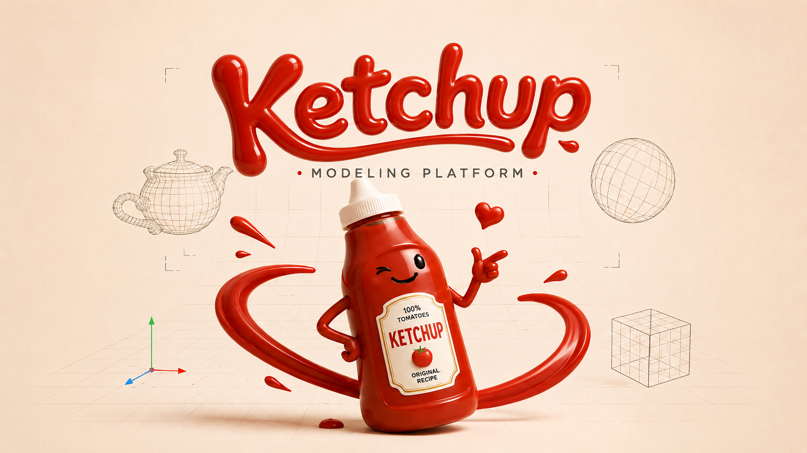
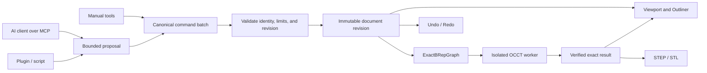

# Ketchup

> [!WARNING]
> ## Work in progress — not a finished product
>
> **Ketchup is under active development and is still far from a finished, stable release.**
>
> You are welcome to download it, build it, and look around — but expect missing features, rough edges, breaking changes, and bugs. Please do not rely on it for real work or keep important models only in Ketchup yet.

<p align="center">
  
</p>

<p align="center">
  <strong>Open-source 2D/3D parametric modeling with exact geometry and safe, undoable AI.</strong>
</p>

<p align="center">
  Windows x86-64 · Rust · Open CASCADE Technology · wgpu · Apache-2.0
</p>

Ketchup is an AI-native desktop modeler for creating, editing, assembling, validating, and exporting real geometry. Manual tools and AI clients connected over MCP share the same canonical command path: every accepted model change is validated, revision-bound, atomic, and undoable.

<p align="center">
  
</p>

## Download and try it

1. Download **`Ketchup-0.1.0-Setup.exe`** from the [latest release](https://github.com/pietrobb/Ketchup/releases/latest) and run it. It installs for the current user only, without administrator rights, into `%LOCALAPPDATA%\Programs\Ketchup` and adds **Ketchup** and **Ketchup Viewer** to the Start menu. If you prefer not to install anything, use `Ketchup-0.1.0-Portable.zip` from the same release.
2. Download **`Ketchup-0.1.0-Examples.zip`** from the release, unpack it, and double-click any `.ketchup` file to open it in Ketchup. Double-click `kitchen.ketchup-view` to open it in Ketchup Viewer. The examples are described [below](#examples-you-can-open-right-away).
3. Optional: connect the AI harness you already use, such as Claude Code, Codex, Claude Desktop, or Cursor. It can then model in the open Ketchup window. See [Connect your AI harness](#connect-your-ai-harness-mcp).

Requires Windows 10 or 11 x64. The installer and the programs are signed by AEON GROUP spol. s r.o. No account, API key, or Python is needed.

## What you can do today

| Model | Organize and edit | Deliver |
|---|---|---|
| Draw line, arc, circle, and rectangle geometry; evaluate represented cubic Bézier sketch curves | Reuse definitions through occurrences and components | Save checksummed `.ketchup` documents with recovery support |
| Extract bounded regions, including profiles with holes | Move, copy, rotate, align, distribute, group, and Make Unique | Import reviewed STEP, STL, DXF, Blender GLB, and `.kscene` subsets |
| Push/Pull, pocket, revolve, sweep, loft, shell, fillet, chamfer, and offset | Build linear, rectangular, and circular patterns | Export current exact geometry to STEP and tessellation to STL |
| Run exact cut, union, intersect, and split operations | Edit ordered feature history, dimensions, visibility, and active bodies | Persist drawing sheets that generate Front/Top/Right assembly views |
| Constrain sketches with dimensional and geometric relationships | Assemble rigid occurrences with stable-reference mates | Inspect validation, loss, reference-health, and failure diagnostics |

Advanced operations are intentionally bounded and fail closed when geometry, identity, resource, or worker guarantees cannot be met. This table describes tested product paths, not unrestricted support for every shape or imported model.

## Examples you can open right away

The examples below are in `Ketchup-0.1.0-Examples.zip` on the [release page](https://github.com/pietrobb/Ketchup/releases/latest) and in the [`examples`](examples) folder of this repository. `tiny-house.ketchup` is too large for the repository; download it from the link in the table. Double-click a file or use **File → Open**.

The [`hettich-quadro-v6-drawer.ketchup`](examples/hettich-quadro-v6-drawer.ketchup) example is an articulated drawer assembly. It combines an editable assembly with embedded exact STEP components, reusable occurrences, stable mechanical references, joints, travel limits, a coordinated motion study, and a persisted mounting contract. Its geometry and engineering intent stay connected, which is what Ketchup is built for.

| Example | Try it for |
|---|---|
| [`hettich-quadro-v6-drawer.ketchup`](examples/hettich-quadro-v6-drawer.ketchup) | The drawer assembly described above, with joints, travel limits, and a motion study. |
| [`table.ketchup`](examples/programs/table.ketchup) | A small table driven by a rule program ([`table.star`](examples/programs/table.star)). It is a good first model to edit by hand or with AI. |
| [`wardrobe-chair-table.ketchup`](examples/wardrobe-chair-table.ketchup) | Furniture with 82 bodies and hundreds of drilled holes. |
| [`tiny-house.ketchup`](https://github.com/pietrobb/Ketchup/releases/download/sample-files/tiny-house.ketchup) | A timber-frame house of about 750 parts, with studs, noggins, and insulation, generated from [`tiny-house.star`](examples/programs/tiny-house.star). You can try layers, material takeoff (**Tools**), and project drawings. A 25 MB download from the [sample files](https://github.com/pietrobb/Ketchup/releases/tag/sample-files) release. |
| [`house-project.ketchup`](examples/house-project.ketchup) | A larger house generated from [`house-project.star`](examples/programs/house-project.star). |
| [`garden-studio-colored.ketchup`](examples/garden-studio-colored.ketchup) | A colored garden studio built from exact solids. |
| [`grooved-beam-array.ketchup`](examples/grooved-beam-array.ketchup) | A 480-occurrence timber stress scene with 24 shared definitions. Use it to test the viewport, selection, the Outliner, and instancing. |
| [`kitchen.ketchup-view`](viewer/samples/kitchen.ketchup-view) | A read-only package for **Ketchup Viewer**, where you can review a model and save comments. |

The rule programs behind several of these models are in [`examples/programs`](examples/programs). An AI harness can read them and use them as templates.

## One path from intent to geometry



AI proposals cannot write around validation, persistence, or Undo/Redo. Stale, invalid, oversized, timed-out, or disconnected proposals are rejected without replacing the last valid model.

## Modeling capabilities

### Sketching and parametric history

- Principal, offset, and planar-face workplanes.
- Line, arc, circle, and cubic Bézier entities with deterministic region extraction and holes.
- Bounded geometric solving for horizontal, vertical, coincident, distance, radius, fixed-point, parallel, perpendicular, tangent, angle, equal, symmetric, concentric, collinear, midpoint, and point-on-curve constraints.
- Ordered body/feature history, dimensional edits, hole/slot repositioning, feature suppression/resume, and multi-body activation.

### Exact geometry

Exact bodies are evaluated through a supervised, versioned worker backed by Open CASCADE Technology. Current bounded operation families include extrusion, pocket, Boolean cut/union/intersect/split, revolve, sweep, loft, shell, fillet, chamfer, and signed planar offset. Accepted results carry freshness and topology evidence before they can drive rendering, picking, or export.

### Assemblies and drawings

Ketchup supports reusable occurrences, grounding, stable-reference planar/axial mates, rigid solve diagnostics, fixed/revolute/prismatic joint data, limits, motion studies, collision/clearance checks, and persisted drawing sheets that generate Front/Top/Right visible-line views. This is an evolving assembly path, not yet a complete mechanical simulation or drafting suite.

### Imports and exports

- **STEP:** exact B-Rep import with preserved source bytes and explicit flattening diagnostics.
- **STL:** binary/ASCII import with declared units and strict closed-manifold validation; no silent repair.
- **DXF:** reviewed bounded 2D geometry subset with a loss report.
- **Blender GLB:** reviewed bounded mesh import preserving names, hierarchy, transforms, opaque colors, and shared instances. Imported geometry remains an explicit `MeshBody`; only recognized simple solids can be explicitly converted after exact verification.
- **SketchUp bridge:** open `.kscene` interchange subset rather than native `.skp` parsing.
- **Export:** current visible exact model to STEP and current tessellation to STL, both with fail-closed freshness/loss checks.

## Connect your AI harness (MCP)

Ketchup has no built-in chat. Instead, you connect the AI harness you already use, such as Claude Code, Codex, Claude Desktop, or Cursor. Your harness keeps its own model, account, and subscription. Ketchup doesn't need an API key.

`Ketchup.exe --mcp` runs a [Model Context Protocol](https://modelcontextprotocol.io) server on stdio. A connected harness works in the Ketchup window you have open. It can read and apply the model's program, inspect parts, make verified edits, undo, save, and render images. It can also import STEP, IGES, STL, DXF, DWG, GLB, and SketchUp scene files, and export STEP, IGES, STL, and the other File-menu formats. Every AI edit goes through the same validation and Undo as a manual edit.

The **Connect AI** section of the window's side panel shows whether a harness is connected. It also has the set-up command with the correct path, ready to copy. With the default installation, the commands are:

Claude Code (PowerShell):

```powershell
claude mcp add ketchup -- "$env:LOCALAPPDATA\Programs\Ketchup\Ketchup.exe" --mcp
```

Codex (PowerShell):

```powershell
codex mcp add ketchup -- "$env:LOCALAPPDATA\Programs\Ketchup\Ketchup.exe" --mcp
```

Other harnesses take the same command in their MCP configuration. Replace `<you>` with your Windows user name:

```json
{ "mcpServers": { "ketchup": { "command": "C:\\Users\\<you>\\AppData\\Local\\Programs\\Ketchup\\Ketchup.exe", "args": ["--mcp"] } } }
```

Then ask the agent, for example, to *"open tiny-house.ketchup in Ketchup and make the house 1 m longer"* or *"model a 120 × 60 cm desk with two drawers"*.

The tools connect to the open window by themselves (with several windows open the agent picks one); if none is open, the agent can start one. A newly connected client replaces the previous one, and the window shows a Disconnect button while a client is connected.

When an agent also develops Ketchup in this checkout, use `scripts\ketchup-mcp-server.cmd` as the command instead. It runs the server from `target\mcp-server` and the windows it opens from copies of the newest build under `target\mcp-windows`, so `cargo build --release` can replace `target\release` while those windows stay open.

## Build and run

The supported development platform is **Windows x86-64** with Rust 1.97.0 and OCCT 8.0.1. See the [Windows toolchain guide](docs/toolchain/WINDOWS.md) for the pinned native environment.

```powershell
cargo build --locked --release
target\release\ketchup-app.exe
```

The release build includes the exact and program workers the window starts beside itself.

Validate the workspace with the commands of [AGENTS.md](AGENTS.md) §6 and §8:

```powershell
cargo test --locked --workspace --all-targets
cargo test --locked --workspace --all-targets -- --ignored large_house
cargo clippy --locked --workspace --all-targets -- -D warnings
cargo fmt --all -- --check
Get-ChildItem scripts\check_*.py | ForEach-Object { python $_.FullName }
python scripts\run_production_tests.py
```

Filter a run after `--` (for example `-- member_design::`). The last command runs the Python tests that drive the built headless CLI and fails on any skip. Install the pre-push hook, which runs fmt, the checks and Clippy, once per clone with `git config core.hooksPath scripts/hooks`.

The Rust workspace also builds on Linux against an OCCT 8.0.1 install in the Unix layout (`include/opencascade`, `lib`). Point `KETCHUP_OCCT_ROOT` at it and make the libraries loadable, for example with `RUSTFLAGS="-C link-arg=-Wl,-rpath,$KETCHUP_OCCT_ROOT/lib"`.

No stable public API or long-term native file-format compatibility is promised yet. Undo/Redo history is currently session-local; saved documents preserve the validated snapshot, not the in-memory history stack.

## Architecture

Ketchup has one canonical, revisioned document and one validated mutation gateway. Geometry workers, rendering, picking, drawings, validation, imports, exports, UI, plugins, and AI are projections or clients of that authority rather than parallel model stores.

Read project authority in this order:

1. [`AGENTS.md`](AGENTS.md): the working rules for every contributor and coding agent. Generic geometry only in the core; validators report instead of blocking; only data-protecting checks.
2. [Accepted ADRs](docs/adr) for the decisions they own. [ADR 0008](docs/adr/0008-retire-gate-governance.md) retired the gate and preregistration process.
3. The [interaction specification](docs/design/README.md) and [implementation plan](docs/design/IMPLEMENTATION_PLAN.md) for UI behavior.
4. [ADR 0009](docs/adr/0009-rule-programs-and-a-generic-core.md) for the current direction: rule programs and a generic core.

Earlier specifications, the execution contract, dated code reviews and working notes are kept in [`docs/archive`](docs/archive) for history only; they are not binding.

## Direction

The model is moving from absolute per-piece geometry to a rule program that the AI or a person writes. Boards, holes and joints will follow from parameters, and validators will report issues instead of rejecting edits. Named-product code paths are being removed; `scripts/check_no_named_products.py` keeps them from returning. See [ADR 0009](docs/adr/0009-rule-programs-and-a-generic-core.md).

## License

Ketchup is licensed under the [Apache License 2.0](LICENSE).
