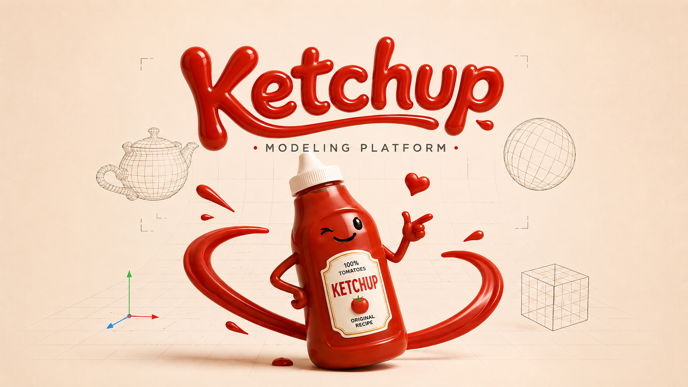
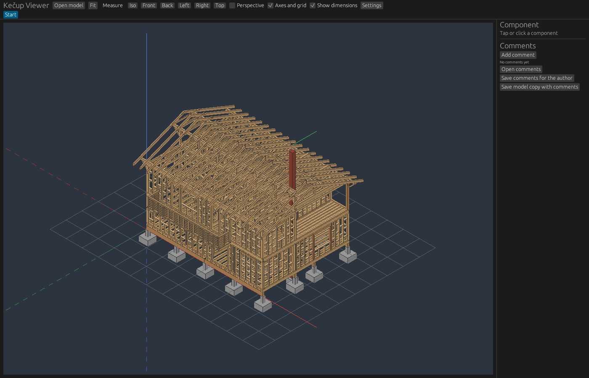
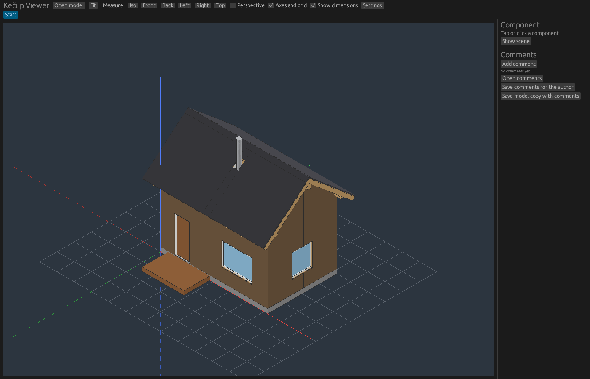
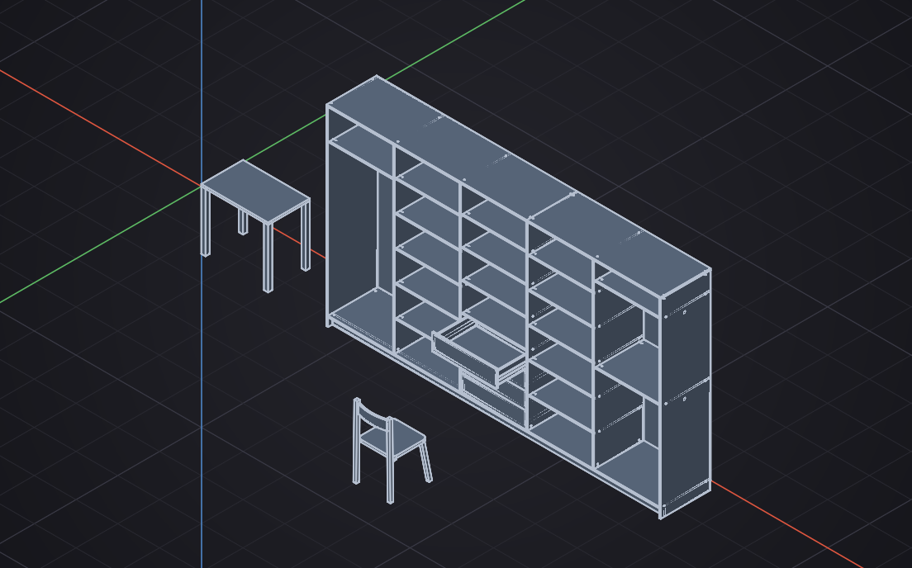
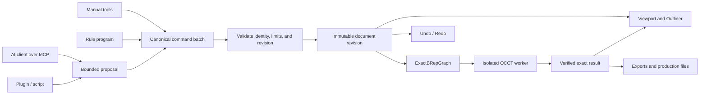

# Ketchup

<p align="center">
  
</p>

<p align="center">
  <strong>Design anything you want to build, check it, and get the drawings, cut lists and CNC files to make it.</strong>
</p>

<p align="center">
  Open source · Exact geometry (Open CASCADE) · Rule programs · Safe, undoable AI over MCP · Windows, with macOS and Linux builds · Apache-2.0
</p>

Ketchup is a 2D/3D modeler for anyone who designs things to be made: furniture, cabinets, a garden studio, a timber-frame house, a machine part. You can draw by hand, describe the model in a few lines of a rule program, or let the AI assistant you already use build it for you. Every change, by hand or by AI, goes through the same checks and the same Undo. When the design is ready, Ketchup gives you drawing sets, cut lists, material takeoffs, quotes and files for CNC machines, and a Viewer package you can send to a customer.

> [!NOTE]
> Ketchup is young and changes quickly. It is usable for the jobs described below, but expect rough edges, and keep copies of important work: the file format can still change between versions. What it does not do yet is listed [near the end](#what-ketchup-does-not-do-yet).

## What people make with it

<p align="center">
  
</p>

<p align="center">
  <em>A timber-frame house of about 1,850 parts — studs, plates, rafters, a chimney and concrete footings — generated from <a href="examples/programs/house-project.star"><code>house-project.star</code></a> and opened in Ketchup Viewer, the free reader you send to your customer.</em>
</p>

<table>
  <tr>
    <td colspan="2"></td>
  </tr>
  <tr>
    <td colspan="2"><em>A tiny house of about 750 parts from <a href="examples/programs/tiny-house.star"><code>tiny-house.star</code></a>: a timber frame with insulation under the cladding, and a concept version on its own layer.</em></td>
  </tr>
  <tr>
    <td colspan="2"></td>
  </tr>
  <tr>
    <td colspan="2"><em>A wardrobe, a chair and a table in the Ketchup editor: 82 bodies with hundreds of drilled holes for dowels and hardware.</em></td>
  </tr>
</table>

## What you can do with it

### Describe a piece of furniture in a few lines

A model can be a short [Starlark](https://github.com/bazelbuild/starlark) rule program. This is the whole [`table.star`](examples/programs/table.star) example:

```python
# Parametric table for the Starlark model-state GUI trial.
WIDTH = param("width", 1200, min = 600, max = 2400)
DEPTH = param("depth", 700, min = 400, max = 1200)
HEIGHT = param("height", 720, min = 400, max = 1100)
TOP = param("top_thickness", 25, min = 15, max = 60)
LEG = param("leg_size", 70, min = 40, max = 120)
INSET = param("leg_inset", 45, min = 20, max = 150)

top = board("table/top", (WIDTH, DEPTH, TOP), at = (0, 0, HEIGHT))
legs = (
    board("table/leg-front-left", (LEG, LEG, HEIGHT), at = (INSET, INSET, 0)),
    board("table/leg-front-right", (LEG, LEG, HEIGHT), at = (WIDTH - INSET - LEG, INSET, 0)),
    board("table/leg-back-left", (LEG, LEG, HEIGHT), at = (INSET, DEPTH - INSET - LEG, 0)),
    board("table/leg-back-right", (LEG, LEG, HEIGHT), at = (WIDTH - INSET - LEG, DEPTH - INSET - LEG, 0)),
)
for leg in legs:
    dowels(top, leg, dowel = "8x40", margin = 15)
```

Each `param()` becomes a field in the parameter panel, and the dowel holes follow when you change the width. Parts can be placed by relation (`on`, `flush`, `between`, `distribute`), machined with holes, pockets, grooves, rebates and booleans, and joined with dowels, hardware and standard fasteners (ISO and DIN nuts, bolts, washers, threaded rods, reinforcing bars). Saved variants keep several sizes of one design; **Export all variants** writes the cut list and material takeoff of each.

You do not have to give up the mouse. Moving, turning, mirroring, deleting, renaming or recolouring a part in the window, or typing a new value for it, is written back into the program, so the model stays parametric. An edit the program cannot express, such as scaling, detaches the program and says which part and why. The language is described in [docs/program-language.md](docs/program-language.md).

### Design a timber-frame house and check it

[`house-project.star`](examples/programs/house-project.star) and [`tiny-house.star`](examples/programs/tiny-house.star) generate whole houses: footings, floors, stud walls with openings, rafters and roof build-ups. Ketchup checks what it builds: collisions and clearances, parts that rest on nothing, load paths with self-weight, imposed and snow loads, and timber members after EN 1995-1-1 (EC5), including lateral-torsional buckling with the bracing it can actually see. Checks list issues; they never stop you from editing.

From the same model you get a numbered drawing set (**File → Drawings (PDF, DXF, DWG)…**): a floor plan of each storey, sections, elevations, a shop drawing of each wall or floor build-up with its pieces numbered and dimensioned, and a schedule of windows and doors, as one PDF or as DXF/DWG sheets. Timber members go to Hundegger BTLx 2.3.1, and the takeoff window exports the material list, a cutting plan on the bars and sheets you buy, and a quote from your own price list.

### Make it: cut lists and CNC files

- Cut lists, hardware lists, bar schedules and material takeoff as CSV or XLSX.
- Cutting plans of every piece on bars and sheets, with kerf, trim and offcuts (`bar_stock`, `sheet_stock`), and quotes from a `price_list`. Ketchup has no prices of its own.
- HOMAG woodWOP programs, one per piece in a ZIP; Hundegger BTLx for timber; a reviewed ISO metric CAM program.
- Every flat part as an AutoCAD R12 DXF in a ZIP, with its outline, cut-outs, holes and pockets on named layers, for any CNC router.
- Sheet-metal flat patterns with bend tables, and weldment cut lists.
- Exports for production refuse to write a file from stale or failed geometry, and say what to fix.

### Work with DXF and DWG drawings

**File → Import → DXF/DWG as underlay…** keeps a site plan or a floor plan under the model. You can snap to it, fit it by two points, and edit it in 2D: delete, move, rotate, mirror, trim, extend, offset, and draw lines, rectangles, circles, arcs and text. **Tools → Export drawing to DXF…** (or **to DWG…**) writes it back with the header, layers, blocks, dimensions and hatches kept, and every unchanged object as it was; the source file is never overwritten. National grid coordinates such as S-JTSK keep their precision. **Tools → Pull drawing area up** turns a room or a parcel into a solid that follows the drawing when it changes.

### Show it to your customer with Ketchup Viewer

Export a `.ketchup-view` package and send it. **Ketchup Viewer** opens it read-only: your customer can orbit the model, switch your saved scenes, pick a part to see its name, material, size and notes, show your dimensions, measure between points, and add comments with arrows and the camera position, then save them in a small file to send back to you, all without being able to change the geometry. The package carries geometry, materials and notes, not your design history or programs.

The Windows Viewer is installed with Ketchup. A macOS app, an Android app and a static web version that runs entirely in the browser ([hosting guide](viewer/web/HOSTING.md)) share its code in `viewer/`.

### Let your AI assistant model it

Ketchup has no built-in chat. You connect the AI harness you already use — Claude Code, Codex, Claude Desktop, Cursor — over the [Model Context Protocol](https://modelcontextprotocol.io), and it works in your open Ketchup window. It can write and patch the rule program, set parameters, inspect and measure parts, render the viewport, import and export files, and edit drawings. Every AI edit goes through the same validation and Undo as yours, so you can always step back.

See [Connect your AI harness](#connect-your-ai-harness-mcp) below for the one-click setup.

### Model mechanical parts and assemblies

- Sketches on any plane with lines, arcs, circles, polygons, ellipses and splines, and constraints (horizontal, vertical, coincident, distance, radius, parallel, perpendicular, tangent, angle, equal, symmetric, concentric, collinear, midpoint, point on curve).
- Exact solids: Push/Pull, pockets, holes with ISO metric threads, revolve, sweep, loft, helix, shell, fillet, chamfer, draft, offset, and Boolean cut, union, intersect and split, with an ordered, editable feature history.
- Assemblies with mates, fixed, revolute, prismatic and helical joints, travel limits, gear, belt, chain, rack and lead-screw couplings, swept collision checks and motion studies. The [`hettich-quadro-v6-drawer.ketchup`](examples/hettich-quadro-v6-drawer.ketchup) example is a drawer on real runners you can open and pull.
- Drawing sheets with front, top, right, isometric, auxiliary, section and detail views, associative dimensions with tolerances, notes and BOM balloons, exported as DXF or DWG.
- Measurement of distances, volume, mass, centre of mass and moments of inertia, and a small linear-static FEA for a first look at stiffness.
- Exchange: STEP and IGES in and out as exact geometry (STEP keeps assembly structure, names and colours), STL, 3MF, Blender GLB, COLLADA for SketchUp, and the `.kscene` SketchUp bridge.

## Download and try it

1. Download **`Ketchup-0.3.2-Setup.exe`** from the [latest release](https://github.com/pietrobb/Ketchup/releases/latest) and run it. It installs for the current user only, without administrator rights, into `%LOCALAPPDATA%\Programs\Ketchup` and adds **Ketchup** and **Ketchup Viewer** to the Start menu. If you prefer not to install anything, use `Ketchup-0.3.2-Portable.zip` from the same release.
2. Download **`Ketchup-0.3.2-Examples.zip`** from the release, unpack it, and double-click any `.ketchup` file to open it in Ketchup. Double-click `kitchen.ketchup-view` to open it in Ketchup Viewer.
3. Optional: connect your AI harness (below) and ask it to *"model a 120 × 60 cm desk with two drawers"*.

Requires Windows 10 or 11 x64. The Visual C++ runtime comes with the programs (only the older 0.3.1 also needs the [Microsoft Visual C++ Redistributable](https://learn.microsoft.com/cpp/windows/latest-supported-vc-redist) for x64, 14.29 or later). The installer and the programs are signed by AEON GROUP spol. s r.o. No account, API key or Python is needed. What changed in each release is in [CHANGELOG.md](CHANGELOG.md).

## Examples you can open right away

The examples are in `Ketchup-0.3.2-Examples.zip` on the [release page](https://github.com/pietrobb/Ketchup/releases/latest) and in the [`examples`](examples) folder. Double-click a file or use **File → Open**.

| Example | Try it for |
|---|---|
| [`table.ketchup`](examples/programs/table.ketchup) | The table program above. A good first model to edit by hand or with AI: your edits are written into the program saved inside the document; [`table.star`](examples/programs/table.star) is that program as it ships, to read. |
| [`wardrobe-chair-table.ketchup`](examples/wardrobe-chair-table.ketchup) | Furniture with 82 bodies and hundreds of drilled holes. |
| [`hettich-quadro-v6-drawer.ketchup`](examples/hettich-quadro-v6-drawer.ketchup) | A drawer assembly with exact STEP hardware, joints, travel limits and a motion study. |
| [`house-project.ketchup`](examples/house-project.ketchup) | The large timber-frame house from [`house-project.star`](examples/programs/house-project.star). Try the drawing set and the material takeoff (**Tools**). |
| [`tiny-house.ketchup`](https://github.com/pietrobb/Ketchup/releases/download/sample-files/tiny-house.ketchup) | The tiny house from [`tiny-house.star`](examples/programs/tiny-house.star), with layers, takeoff and project drawings. A 25 MB download from the [sample files](https://github.com/pietrobb/Ketchup/releases/tag/sample-files) release. |
| [`garden-studio-colored.ketchup`](examples/garden-studio-colored.ketchup) | A coloured garden studio built from exact solids. |
| [`grooved-beam-array.ketchup`](examples/grooved-beam-array.ketchup) | 480 occurrences of 24 shared definitions, to try the viewport, selection, the Outliner and instancing. |
| [`kitchen.ketchup-view`](viewer/samples/kitchen.ketchup-view) | A package for **Ketchup Viewer**, where you can review a model and save comments. |

More programs you can run on an empty model are in [`examples/programs`](examples/programs): a cabinet, a modular doweled cabinet, shelves on a shared partition, a round stool and an anchored beam. An AI harness can read them and use them as templates.

## Connect your AI harness (MCP)

Your harness keeps its own model, account and subscription; Ketchup doesn't need an API key. `Ketchup.exe --mcp` runs an MCP server on stdio, and a connected harness works in the Ketchup window you have open. Besides modeling, it can import STEP, IGES, STL, DXF, DWG, GLB and SketchUp scene files, read a drawing as objects, closed regions (rooms) and parallel line pairs (wall thicknesses), edit it (remove, draw, move, trim, extend, offset), and export everything the window can, including project drawings as PDF.

Set it up once, in any of these ways:

- **Installer:** keep *Connect your AI clients to Ketchup* checked on its last page.
- **Window:** the **Connect AI** section of the side panel lists Claude Code, Codex, Claude Desktop and Supervisor. **Connect** writes this Ketchup into the client's own configuration (`.claude.json`, `.codex\config.toml`, `claude_desktop_config.json`, Supervisor's `skills\mcp_servers.json`), so it works even when the client's command is not on the window's PATH; **Use this Kečup** replaces an entry that starts another program, for example a deleted development build.
- **Terminal:** `& "$env:LOCALAPPDATA\Programs\Ketchup\Ketchup.exe" --mcp-setup | Out-Host` sets up every client it finds and prints what each starts now.
- **By hand**, with the default installation:

Claude Code (PowerShell). `--scope user` makes the server available in every folder:

```powershell
claude mcp add --scope user ketchup -- "$env:LOCALAPPDATA\Programs\Ketchup\Ketchup.exe" --mcp
```

Codex (PowerShell):

```powershell
codex mcp add ketchup -- "$env:LOCALAPPDATA\Programs\Ketchup\Ketchup.exe" --mcp
```

Other harnesses take the same command in their MCP configuration. Replace `<you>` with your Windows user name:

```json
{ "mcpServers": { "ketchup": { "command": "C:\\Users\\<you>\\AppData\\Local\\Programs\\Ketchup\\Ketchup.exe", "args": ["--mcp"] } } }
```

Then start a new session of the harness and ask, for example, to *"open tiny-house.ketchup in Ketchup and make the house 1 m longer"*.

The tools connect to the open window by themselves (with several windows open the agent picks one); if none is open, the agent can start one. A newly connected client replaces the previous one. While a client is connected, the status line names it (*Connected AI: Claude Code*) next to a **Disconnect** button. Documents the agent opens or saves join **File → Open Recent**.

When an agent also develops Ketchup in this checkout, use `scripts\ketchup-mcp-server.cmd` as the command instead. It runs the server from `target\mcp-server` and the windows it opens from copies of the newest build under `target\mcp-windows`, so `cargo build --release` can replace `target\release` while those windows stay open. **Connect** and `--mcp-setup` in a window built in this checkout register it. By hand, from the checkout root (PowerShell):

```powershell
claude mcp add --scope user ketchup -- "$PWD\scripts\ketchup-mcp-server.cmd"
codex mcp add ketchup -- "$PWD\scripts\ketchup-mcp-server.cmd"
```

If the server does not start, the script writes the reason to stderr, which the harness shows in its MCP log; for example, there is no `target\release\ketchup-app.exe` yet because `cargo build --release` has not run.

## How a change reaches the model



Manual tools, rule programs, plugins and AI all change the model through one command path: every accepted change is validated, atomic and one Undo step. Stale, invalid, oversized, timed-out or disconnected AI proposals are rejected without replacing the last valid model. Exact geometry is computed by Open CASCADE Technology in a supervised worker process, so a crash there cannot take your document with it; a crash of the window leaves a work-recovery copy beside the file.

## What Ketchup does not do yet

Honest limits, so you know where it stands next to a mature mechanical CAD such as SolidWorks:

- **Drawings for machined parts are not complete.** The drawing format holds angular, radius and diameter dimensions, datums and GD&T feature control frames, but no tool places them yet; linear dimensions with tolerances, notes and BOM balloons work. There are no automatic hole and thread callouts.
- **No native SolidWorks, Parasolid or SketchUp `.skp` files.** Use STEP or IGES (exact) for CAD exchange and COLLADA or `.kscene` for SketchUp.
- **No catalogue of standard mechanical parts** such as bearings, linear rails, ball screws or aluminium profiles. The program library has standard fasteners, dowels and hinges; other supplier parts come in as STEP.
- **Simulation is basic.** Load paths, EC5 timber checks and a small linear-static FEA (trusses and tetrahedra, up to 4,096 elements) — not nonlinear, thermal, dynamic or fatigue analysis.
- **CAM is limited.** Drilling programs for woodWOP, BTLx for timber, R12 DXF outlines for CNC routers and one reviewed ISO metric program; no general toolpath generation or post-processors for arbitrary machines. woodWOP contour milling and pockets are in progress.
- **Exact operations are bounded.** Fillet, shell, sweep, loft and Booleans cover tested cases and fail with an explanation rather than produce doubtful geometry. Freeform surfacing is not there.
- **Undo history lives in memory** for the session and reaches back 30 edits; Save writes only the current revision. A work-recovery copy keeps your edits and their Undo steps through a crash.
- **One memory limit per kind of background job**, not for the whole window: several large imports and exports at once can use more memory than the computer has.
- **Windows is the supported desktop platform.** macOS and Linux builds work from source (below); the installer and signed release are Windows-only.
- **No stable public API or long-term file-format promise yet.** A newer Ketchup opens older files. A document without underlays and annotations whose imports stay within the limits of 0.2.0 (at most 1 024 objects made by one import, a DXF source of at most 8 MiB, other sources of at most 32 MiB) is saved so that 0.2.0 opens it too. Ketchup 0.2.0 and later refuse a file a newer version saved and change nothing. **Do not open files saved by a later version in 0.1.0:** it takes them for damaged files and may open an older `.recovery` copy instead, and saving there can overwrite the newer file.

## Where it goes next

The next steps that would move Ketchup furthest toward a full production CAD:

1. Tools to place angular, radial and diameter dimensions, GD&T frames and hole/thread callouts on drawing sheets.
2. A library of standard parts (bearings, linear rails, ball screws, aluminium profiles, motors) as rule-program components with exact geometry.
3. General CAM: 2.5D toolpaths (contours, pockets, drilling) with post-processors for common controllers, beyond woodWOP and BTLx.
4. Broader exact modeling: more fillet and shell cases, variable-radius fillets and surfaces.
5. Stronger simulation for machine frames: stiffness and modes of a whole assembly.

With these, Ketchup could design a machine like its own CNC router end to end: frame from aluminium profiles, linear rails and ball screws from the parts library, drawings with tolerances for the machined plates, and toolpaths to make those plates.

## Build and run

The supported development platform is **Windows x86-64** with Rust 1.97.0 and OCCT 8.0.1. See the [Windows toolchain guide](docs/toolchain/WINDOWS.md) for the pinned native environment.

```powershell
cargo build --locked --release
target\release\ketchup-app.exe
```

The release build includes the exact and program workers the window starts beside itself.

Validate the workspace with the commands of [AGENTS.md](AGENTS.md) §6 and §8:

```powershell
cargo test --locked --workspace --all-targets
cargo test --locked --workspace --all-targets -- --ignored large_house
cargo clippy --locked --workspace --all-targets -- -D warnings
cargo fmt --all -- --check
Get-ChildItem scripts\check_*.py | ForEach-Object { python $_.FullName }
python scripts\run_production_tests.py
```

Filter a run after `--` (for example `-- member_design::`). The last command runs the Python tests that drive the built headless CLI and fails on any skip. Install the pre-push hook, which runs fmt, the checks and Clippy, once per clone with `git config core.hooksPath scripts/hooks`.

The Rust workspace also builds on Linux, against the pinned OCCT 8.0.1 built by `scripts/linux/build-occt.sh` (it needs CMake, Ninja and clang). A system or distribution OCCT does not work: the build links CORE-MATH (`third_party/crmath`, [ADR 0010](docs/adr/0010-correctly-rounded-libm.md)) into every OCCT library and installs `libketchup_crmath.a` beside them, so OCCT computes the same bits as on Windows and macOS instead of calling glibc's `sin`, `pow` and the like. Make the libraries loadable with an rpath:

```bash
git clone https://github.com/Open-Cascade-SAS/OCCT.git third_party/occt-src
git -C third_party/occt-src checkout b8f597c677811d1f9f4d8a97f5ae2825c0353a42
scripts/linux/build-occt.sh
export RUSTFLAGS="-C link-arg=-Wl,-rpath,$PWD/third_party/occt-install-r0-v1/lib"
cargo build --locked --release
```

On an Apple Silicon Mac, with the Xcode command line tools, CMake and Ninja, `scripts/macos/build-occt.sh` builds the same pinned OCCT 8.0.1 with CORE-MATH linked in (arm64; `KETCHUP_OCCT_ARCHS` for others). The libraries carry their install path, so `cargo build` and `cargo test` find them without an rpath:

```bash
git clone https://github.com/Open-Cascade-SAS/OCCT.git third_party/occt-src
git -C third_party/occt-src checkout b8f597c677811d1f9f4d8a97f5ae2825c0353a42
scripts/macos/build-occt.sh
cargo build --locked --release
scripts/macos/build-app.sh            # Kečup.app and a .dmg in artifacts/macos-app/<version>
scripts/macos/build-viewer-app.sh     # Kečup Viewer.app (arm64 + x86_64) and a .dmg
```

Both app scripts write the third-party notices with `scripts/third_party_notices.py`, which needs Python 3 and cargo-about 0.9.2, the version CI pins (`cargo install cargo-about --version 0.9.2 --locked`); so do the Windows packages. Both sign ad hoc, for this Mac; `--sign "Developer ID Application: …"` signs for other Macs, and notarization is a separate step.

`KETCHUP_OCCT_ROOT` points the build at an install elsewhere. CI builds and tests the crates with OCCT on Linux and Windows on every pull request, and on macOS builds the app bundle and runs the live tests against it.

## Architecture

Ketchup has one canonical, revisioned document and one validated mutation gateway. Geometry workers, rendering, picking, drawings, validation, imports, exports, UI, plugins and AI are projections or clients of that authority rather than parallel model stores.

Read project authority in this order:

1. [`AGENTS.md`](AGENTS.md): the working rules for every contributor and coding agent. Generic geometry only in the core; validators report instead of blocking; only data-protecting checks.
2. [Accepted ADRs](docs/adr) for the decisions they own. [ADR 0009](docs/adr/0009-rule-programs-and-a-generic-core.md) sets the current direction: rule programs and a generic core, with named-product code paths removed and kept out by `scripts/check_no_named_products.py`.
3. The [interaction specification](docs/design/README.md) and [implementation plan](docs/design/IMPLEMENTATION_PLAN.md) for UI behavior.

Earlier specifications, dated code reviews and working notes are kept in [`docs/archive`](docs/archive) for history only; they are not binding.

## License

Ketchup is licensed under the [Apache License 2.0](LICENSE).
